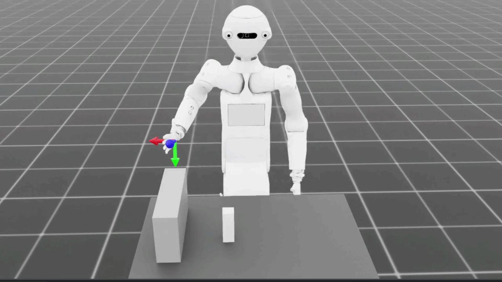
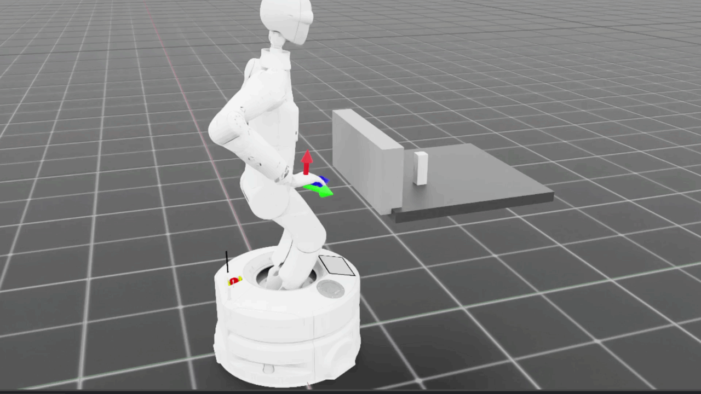
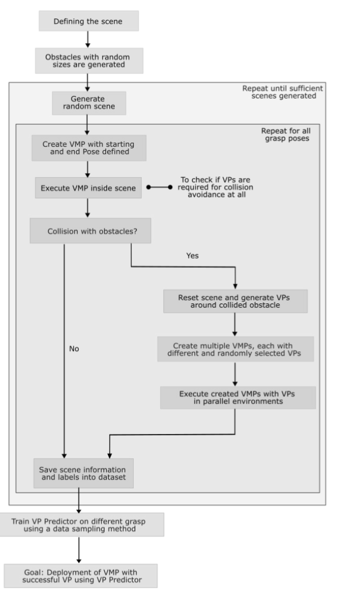
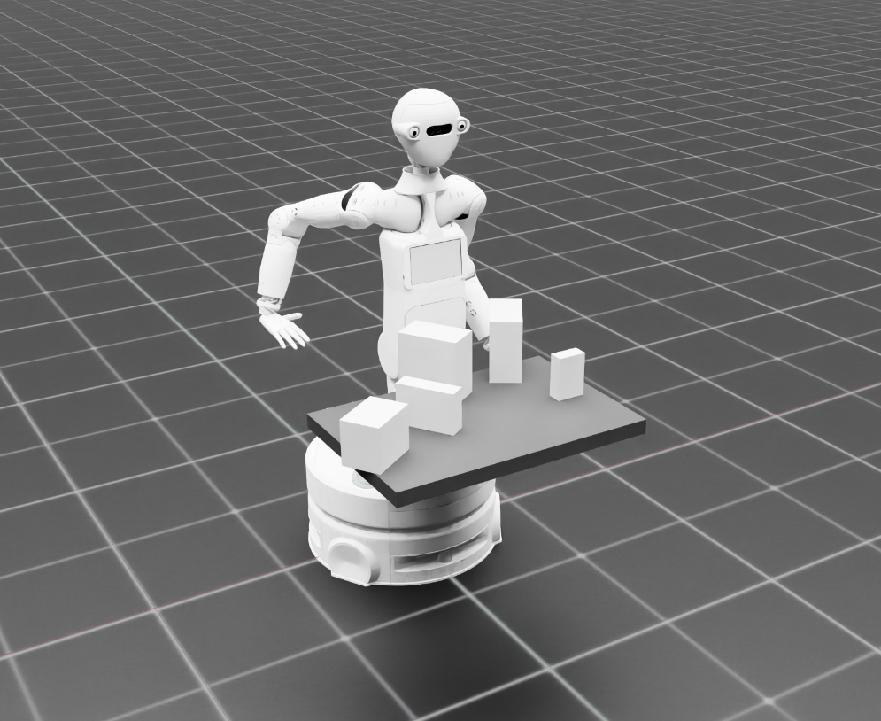
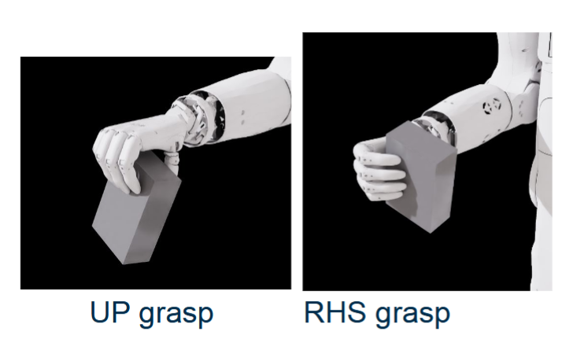
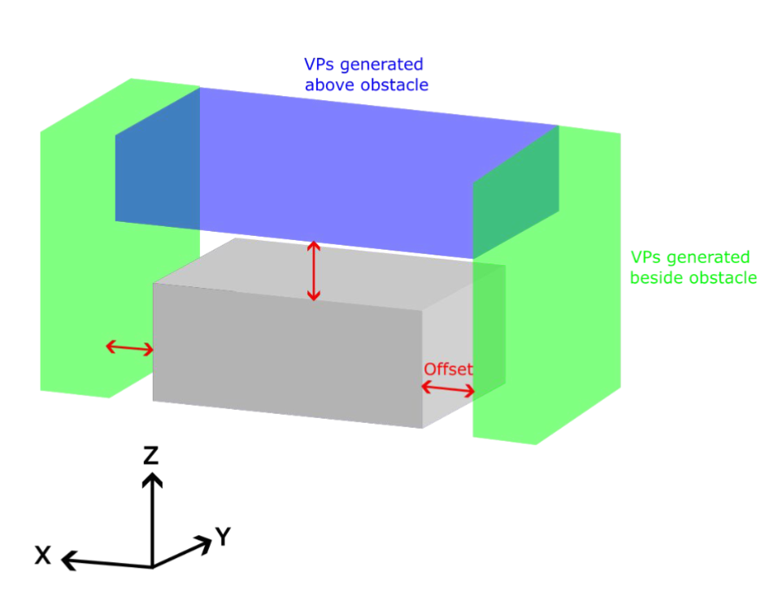
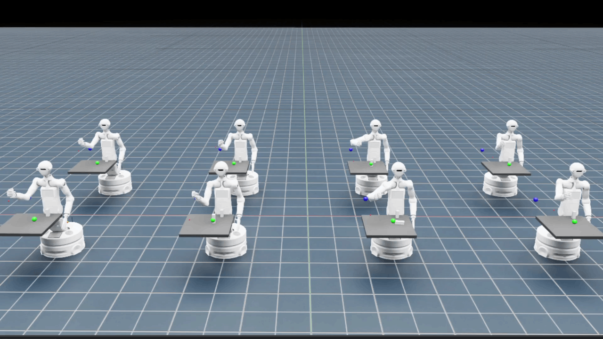
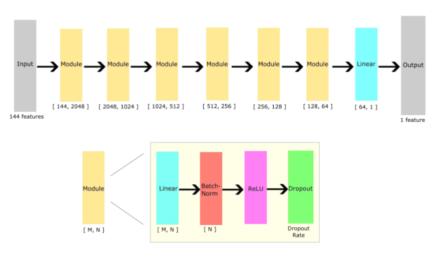
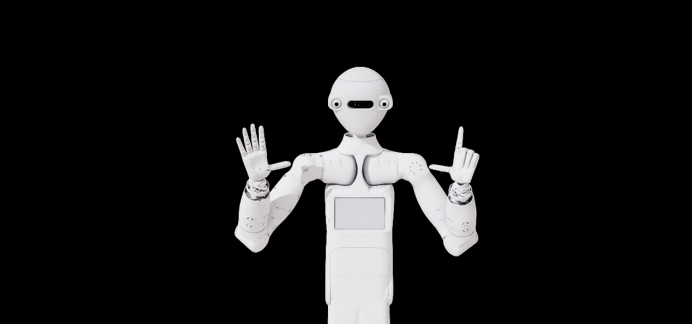

# Bachelor's Thesis: Imagination for Via-Point Generation in Via-Point Movement Primitives (VMPs)

- **Bachelor's Thesis Presentation & Project Documentation**
- **Author:** Kai Yen Chang
- **Date:** November 27, 2025
- **Supervisors:** Sebastian Rietsch, Joana Plewnia
- **Institution:** High Performance Humanoid Technologies ([H²T](https://h2t.iar.kit.edu/)), Karlsruhe Institute of Technology ([KIT](https://www.kit.edu/english/))
- **Target Robot Platform:** ARMAR7 [Humanoid Robot](https://h2t.iar.kit.edu/397.php)


## 📖 Table of Contents

1. [Overview & Motivation](#overview--motivation)

2. [Concept of Robot Imagination](#concept-of-robot-imagination)

3. [Methodology & Pipeline](#methodology--pipeline)

   * [Simulation Environment & Scene Definition](#simulation-environment--scene-definition)

   * [Collision Check & Via-Point (VP) Candidate Generation](#collision-check--via-point-vp-candidate-generation)

   * [Parallel Simulation & Dataset Construction](#parallel-simulation--dataset-construction)

4. [VP Predictor Architecture](#vp-predictor-architecture)

5. [Data Sampling Strategies](#data-sampling-strategies)

6. [Experimental Evaluation & Results](#experimental-evaluation--results)

   * [Evaluation Setup & Metrics](#evaluation-setup--metrics)

   * [Known Scenes Benchmark](#known-scenes-benchmark)

   * [Unknown Scenes Benchmark](#unknown-scenes-benchmark)

   * [Real-World Deployment Insights](#real-world-deployment-insights)

7. [State of the Art & Related Works](#state-of-the-art--related-works)

8. [Future Work](#future-work)

9. [References](#references)

## 1. Overview & Motivation

* **Movement Primitives (MPs):** Parameterized, reusable trajectory representations frequently deployed for versatile robot manipulation.

* **Via-Point Movement Primitives (VMPs):** An extension allowing intermediate spatial/temporal constraints—*Via-Points (VPs)*—to be inserted dynamically, enabling active trajectory modification and obstacle avoidance.

</br>


</br>

* **The Problem:**

  1. **Manual Selection Overhead:** Tuning and verifying viable via-points through trial-and-error is computationally expensive, unintuitive, and time-consuming.

  2. **Physical Risk:** Direct online trial-and-error execution of unverified VPs on physical humanoid robots (such as ARMAR-7) risks severe hardware collisions or environmental damage.
</br>


</br>

* **The Solution:** A predictive data-driven framework inspired by *simulation-based imagination*, where simulated parallel environments identify, sample, and label viable collision-free via-points to train a deep neural **VP Predictor**.

## 2. Concept of Robot Imagination

Following definitions from recent robotic manipulation literature (e.g., Li et al., 2024; Di Palo & Johns, 2020), **Imagination** in this framework operates under three principles:

1. **Scene Digitalization:** A real-world or parameterized workspace is accurately reconstructed inside a high-fidelity physics simulator.

2. **Mental Sandbox Simulation:** Counterfactual actions (trajectories with randomized via-point candidates) are executed purely in simulation across parallel instances.

3. **Selective Execution:** Only the certified optimal, collision-free action is selected for execution on physical hardware.

> *Note:* This thesis acts as a foundational **proof-of-concept (PoC)** demonstrating end-to-end data collection, learning, and prediction for collision-avoiding VPs.

## 3. Methodology & Pipeline


### Simulation Environment & Scene Definition

* **Robot Model:** KIT ARMAR-7 Humanoid Robot.

* **Task Scenario:** Tabletop pick-and-place reaching task.

  * **Target Object:** Rectangular cuboid modeled after a standard cereal box.

  * **Obstacles:** Four obstacles with randomized 3D bounding geometry, positions, and orientations.
</br>


</br>

  * **Tested Grasp Configurations:**

    * **UP Grasp:** Overhead approach / grasp downward onto the object.

    * **RHS (Right-Hand Side) Grasp:** Lateral approach slicing horizontally across workspace clutter.
</br>


</br>
### Collision Check & Via-Point Candidate Generation

1. Initial end-effector reaching trajectories are planned using default VMP formulations.

2. If an obstacle intersection is detected, candidate 3D Via-Points are sampled within structured volumetric safety corridors:

   * **Above the obstacle:** Discretized grid layers elevated in the $+Z$ axis.

   * **Beside the obstacle:** Lateral offsets in the local bounding $XY$ plane.
   

### Parallel Simulation & Dataset Construction

* Each candidate via-point is instantiated in parallel simulated ARMAR-7 environments.

* Trajectories are evaluated for kinematic reachability and collision freedom:

  * $\text{Label} = 1$: Collision-free, successful reaching motion.

  * $\text{Label} = 0$: Collision occurred (with obstacle, table, or self-collision).



## 4. VP Predictor Architecture

The core predictor is a deep **Multilayer Feedforward Neural Network (MLP)** that acts as a binary classifier evaluating whether a candidate via-point in a specified scene configuration will succeed.

### Network Topology

* **Input Layer:** $144$ handcrafted geometric and scene features (end-effector coordinates, grasp target pose, obstacle dimensions, relative distances, VP candidate 3D offset, canonical timings).

* **Layer Sequence:**
  

  $$
  \mathbf{144} \longrightarrow [2048] \longrightarrow [1024] \longrightarrow [512] \longrightarrow [256] \longrightarrow [128] \longrightarrow [64] \longrightarrow \mathbf{1}
  $$

* **Modular Block Structure:**

  Each hidden module contains:
  

  $$
  \text{Input} \longrightarrow \text{Linear}(M, N) \longrightarrow \text{BatchNorm1d}(N) \longrightarrow \text{ReLU} \longrightarrow \text{Dropout}(p) \longrightarrow \text{Output}
  $$

* **Output:** $1$ scalar logit passed to a sigmoid function during inference ($\hat{y} \in [0, 1]$).

* **Loss Function:** Binary Cross-Entropy with Logits Loss ($\text{BCEWithLogitsLoss}$):
  

  $$
  L = -\frac{1}{N}\sum_{i=1}^{N} \left[ y_i \log \sigma(\hat{y}_i) + (1 - y_i) \log(1 - \sigma(\hat{y}_i)) \right]
  $$

* **Training Horizon:** $200$ epochs (empirical performance plateaus after $200$).
</br>


</br>

## 5. Data Sampling Strategies

The raw generation process yields severe class imbalance due to high obstacle density (typical failure-to-success ratios exceed $10:1$ to $15:1$). Three sampling approaches were evaluated:

1. **Baseline Sampling:**

   * Uses raw, unaltered class distributions.

   * Preserves natural prior probabilities but risks conservative failure-biased predictions.

2. **Drop Data (Under-sampling):**

   * Stochastically removes excess negative samples (failures) until a balanced $1:1$ positive-to-negative ratio is reached.

   * Drastically shrinks dataset size while mitigating majority class dominance.

3. **Random Weighted Sampling (RWS):**

   * Retains all samples but assigns higher sampling weights to positive (success) examples during batch generation.

## 6. Experimental Evaluation & Results

### Dataset Splits

* **Dataset Scale:** Evaluated across multiple sub-datasets totaling over $1.5$ million simulated executions.

* **Known Scenes:** $80/20$ train-test split across standard recorded scenes.

* **Unknown Scenes:** Completely held-out spatial layouts (Dataset 3) not seen during training.

### Summary of Dataset Distributions

| Grasp Type | Total Scenes | Valid Samples | True (Success) | False (Fail) | 
| ----- | ----- | ----- | ----- | ----- | 
| **RHS Grasp (Datasets 1–8)** | \~3,200 | \~1,070,000 | \~99,000 | \~971,000 | 
| **UP Grasp (Datasets 1–8)** | \~4,100 | \~900,000 | \~56,000 | \~844,000 | 

### Comparative Performance Breakdown

#### Known Scenes Performance

* **Drop Data** achieves the highest precision and F1 score:

  * Yields average precision of $0.94$ across both grasp types.

  * Eliminates false positives effectively, preventing overfitting to clutter on known geometry.

* **Baseline:**

  * Average Precision: $0.825$**–**$0.83$.

  * A roughly $17\%$ residual false-positive rate makes raw baseline inference suboptimal on known setups.

* **Random Weighted Sampling (RWS):**

  * Substantial increase in false negatives (up to $250\%$ higher), causing degraded overall generalization.

#### Unknown Scenes Performance

* **The Generalization Shift:** On previously unseen workspace layouts, scene unpredictability spikes significantly.

* **Drop Data Fails to Generalize:**

  * Experiences severe drops in precision and produces high training/testing loss due to lack of diverse negative boundary samples.

* **Baseline Excels on Unknown Layouts:**

  * Achieves the highest precision ($0.61$ average across grasps).

  * Retains conservative decision boundaries, rejecting uncertain via-points.

### Key Deployment Insights

> **Primary Rule for Humanoid Deployment:**
>
> **High Precision (**$TP / (TP + FP)$**)** is the critical metric. In physical humanoid robotics, false positives lead to commanding real hardware into unviable via-points resulting in real collisions.
>
> * **Selected Model for Production Deployment:** **Baseline Sampling** offers the most balanced performance across known and unseen workspaces without requiring dual networks.

## 7. State of the Art & Related Works

This thesis synthesizes concepts from three robotic learning paradigms:

1. **Via-Point Movement Primitives (VMPs):**

   * *Zhou et al. (IROS 2019):* Extends DMPs with via-point interpolation and extrapolation capabilities.

   * *Jing et al. (IROS 2019):* Voxel-based via-point extraction used in UAV visual inspection coverage planning.

2. **Neural Networks for Movement Primitives:**

   * *Pervez et al. (Humanoids 2017):* Deep CNN architectures predicting task-specific parameters for dynamic movement primitives.

   * *Seker et al. (RSS 2019):* Conditional Neural Movement Primitives (CNMPs) learning distributions over trajectories for obstacle avoidance.

3. **Robot Imagination & Latent Rollouts:**

   * *Barcellona et al. (2024 - "Dream to Manipulate"):* Compositional world models for robot imitation learning inside latent physics sandboxes.

   * *Di Palo & Johns (2020 - "SAFARI"):* Safe active robot imitation learning evaluating forward policy rollouts in imagination before hardware actuation.

   * *Li et al. (2024):* Planning-guided diffusion policies for contact-rich manipulation.

## 8. Future Work

* \[ \] **First-Person Sim-to-Real Imagination:** Close the simulation loop by capturing real RGB-D inputs directly from head cameras on ARMAR-7 to instantiate scenes in Isaac Sim / CoppeliaSim.

* \[ \] **End-to-End Visual Predictors:** Replace 144 handcrafted tabular features with raw 3D Point Clouds (PointNet++) or egocentric depth images.

* \[ \] **Generative VP Pose Synthesizers:** Implement conditional diffusion models or CVAEs to directly generate successful 6-DoF via-point poses rather than filtering discrete grids.

* \[ \] **Canonical Time Prediction:** Formulate joint prediction of both the 3D via-point coordinates and its temporal canonical phase $\tau_{vp} \in [0, 1]$.

* \[ \] **Multi-MP Generalization:** Extend beyond single pick-and-place primitive libraries to composite multi-stage humanoid manipulation sequences.

## 9. References

1. Y. Zhou, J. Gao, and T. Asfour, *"Learning Via-Point Movement Primitives with Inter- and Extrapolation Capabilities,"* IEEE/RSJ IROS, 2019.

2. W. Jing et al., *"Coverage Path Planning using Path Primitive Sampling and Primitive Coverage Graph for Visual Inspection,"* IEEE/RSJ IROS, 2019.

3. A. Pervez, Y. Mao, and D. Lee, *"Learning deep movement primitives using convolutional neural networks,"* IEEE-RAS Humanoids, 2017.

4. M. Y. Seker, M. Imre, J. Piater, and E. Ugur, *"Conditional neural movement primitives,"* Robotics: Science and Systems (RSS), 2019.

5. L. Barcellona et al., *"Dream to manipulate: Compositional world models empowering robot imitation learning with imagination,"* arXiv:2412.14957, 2024.

6. N. Di Palo and E. Johns, *"SAFARI: Safe and active robot imitation learning with imagination,"* arXiv:2011.09586, 2020.

7. X. Li et al., *"Planning-guided diffusion policy learning for generalizable contact-rich bimanual manipulation,"* Dec. 2024.

---
 ```
The end
Thanks for your attention!
```

